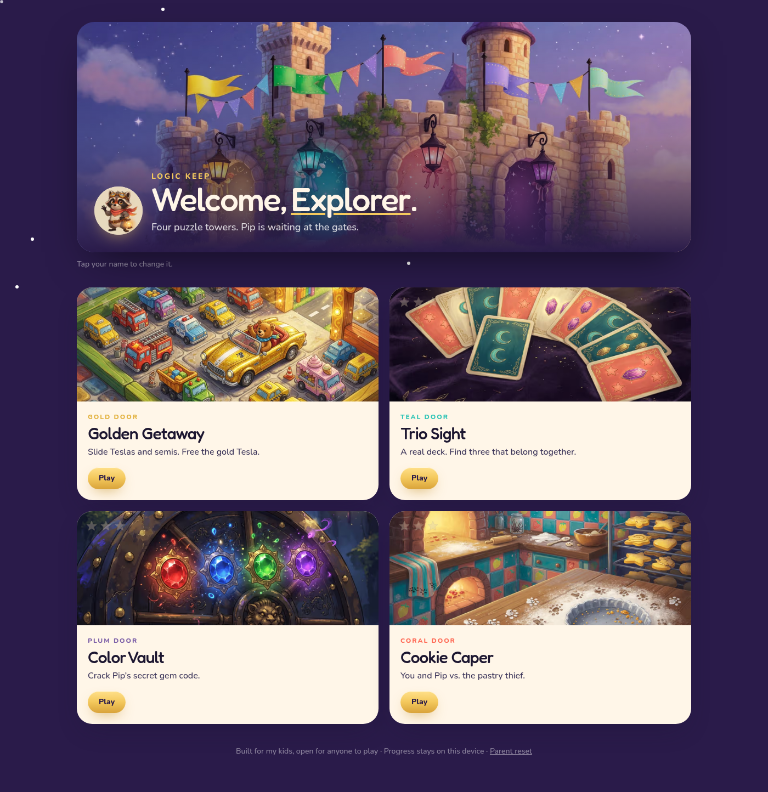
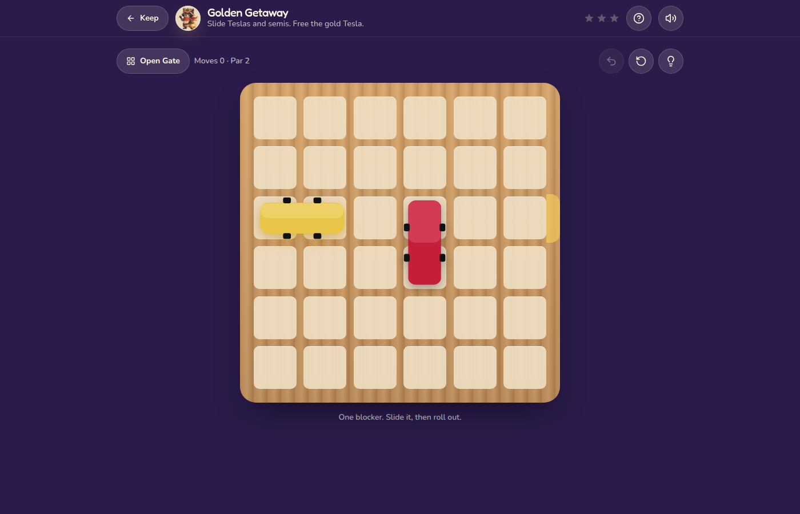
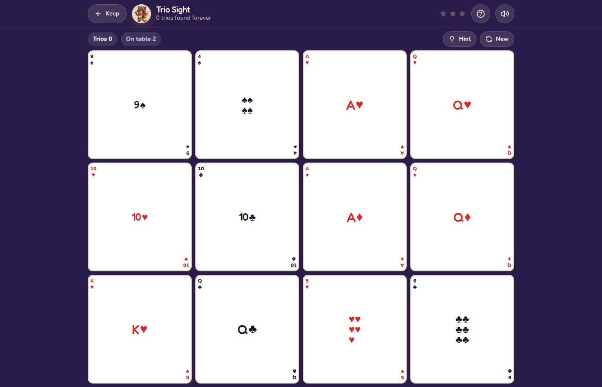
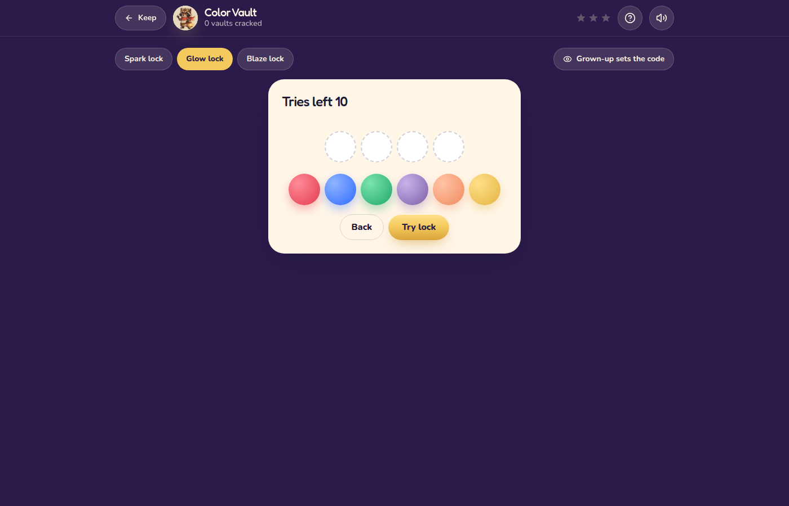
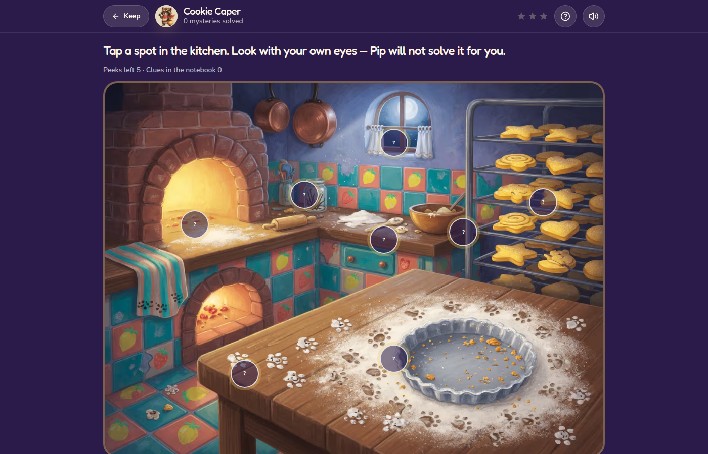

# Logic Keep

I wanted screen time to build reasoning skills instead of just burning time. Logic Keep is a puzzle castle of four original browser games. Pip the raccoon keeps the gates. There are no accounts. Progress stays in the browser.

Built for my kids, open for anyone to play.

Live demo: add the public URL here when the site is deployed.

## The problem

A lot of kids' screen time is just more scrolling. I wanted a place they could sit with a puzzle: slide the traffic, find the set, crack the code, and decide who the clues still fit. The games had to work on a normal browser, with progress that stayed on the device.

## What I built

- **Golden Getaway** — slide Teslas and semis on a 6×6 lot until the gold Tesla can leave through the gate.
- **Trio Sight** — find three of a kind, or three in a row of the same suit, from a standard deck.
- **Color Vault** — guess a hidden gem code. A gold key means the right gem in the right place. A silver key means the right gem in the wrong place.
- **Cookie Caper** — search the bakery kitchen, read the notebook, cross off bakers yourself, and accuse the thief.











## How it works

Each game is a client component. The board, the current guess, and the kitchen clues live in React state for that visit.

Progress is one JSON object in `localStorage`, under the key `logic-keep-progress-v1`. The `useProgress` hook reads it after the page loads and writes it back when stars, wins, the player name, or the mute setting change. A reload keeps that data. Nothing is sent to a server.

Routes:

- `/` is the castle. Four doors, the saved name, and stars for each game.
- `/play/getaway`, `/play/trios`, `/play/vault`, and `/play/caper` are the games.
- `/parent` shows the saved progress for this browser and can reset it.

## Tech stack

Next.js 16 (App Router), React 19, TypeScript, and Tailwind CSS 4. Icons come from lucide-react. Wins use canvas-confetti. Nunito and Fredoka load through `next/font`.

## Run locally

```bash
npm install
npm run dev
```

Open http://localhost:3000

```bash
npm run lint
npm run build
npm start
```

The app does not need environment variables.

## What I learned

The rules are easier to trust when they live in plain TypeScript, apart from the screens. Golden Getaway, Trio Sight, Color Vault, and Cookie Caper each have an engine that decides a legal move, a match, or a win. The React components only draw that state and call back when something is scored.

One `localStorage` blob is enough when there are no accounts. The castle, the games, and `/parent` all read the same hook, so a star earned in a game is still there after a reload.

Playtesting changed the games. The gold Tesla leaves the board, and Trio Sight fits on one screen. Those rules live in the puzzle engines.

## Built with AI

Robert Baker directed Cursor and Grok, then tested the result.
